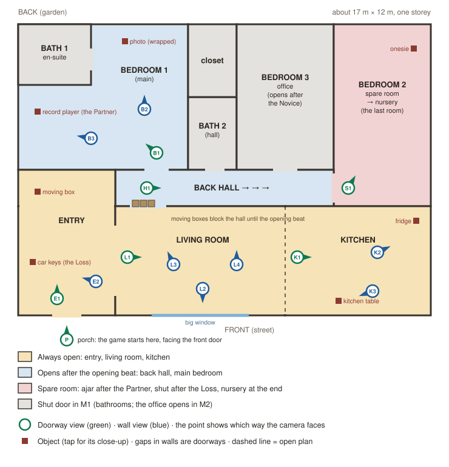

# The House: floor plan

**Status:** Settled for M1 (Dan, 2026-10-22: "settled for M1 until it can be seen in the game"; [scope.md](../scope.md) Settled questions). The M1 rows below are what the core table (`game/_core/house/house_table.gd`) builds from; change this file first, then the table. The open calls at the end are M2's. History: draft for Dan to edit, 2026-10-18 (third pass, made with the [narrative-craft skill](../../.claude/skills/narrative-craft/SKILL.md)). Most of Dan's calls were decided on 2026-10-19 (see "Dan's calls" at the end); the spare room's role, the memory box, the House objects and the record player's later life are still open. Answers the question in [scope.md](../scope.md): "The House's small floor plan: which rooms, where the chapter objects sit" (needed by M1).

Dan's direction, 2026-10-18: **3 bedrooms, 2 bathrooms.** The living room and kitchen are always open, because every house has them. The nursery is not near the front door. Think about where Leo starts, how he moves through the House as the story goes, and how places open up.

Every object and room here has a lifeline in the [continuity ledger](continuity-ledger.md). Lines marked **Dan** are his calls; the full list is at the end.

## The feeling

Walking into a house that isn't home yet, and finding that the story walks you deeper into it, until the last room you reach is the one that was waiting at the end of the hall the whole time.

## Recommended concept: "The room for later"

**Central image:** a shut door at the end of the hall. Behind it is the spare room, where Leo's old life was dumped on moving day. It is the last room to become what it is for. The nursery is made, at the end, by clearing out the life Leo had before: the game's arc from "Me" to "Us", as a room.

### The shape of the House

One storey, built front to back, like a real house: the shared rooms at the front, the private rooms behind, the spare room deepest of all.

Read it from the bottom (the street) up. The front door is bottom left. The entry, living room and kitchen run along the front and are always open. Behind them, the **back hall** (the blue strip) runs left to right, from an opening in the living room's back wall to the spare room's door at its far end. The main bedroom, the hall bathroom and the office open off its top side.

About 17 m by 12 m. The back hall runs straight from the living room to the spare room's door, so from the moment the hall opens, the player can see that door at the end of it. The spare room is in the back corner diagonally opposite the front door, as far from it as the House allows.

Because the player only sees framed shots ([ADR-0003](../adr/0003-house-fixed-viewpoints.md)), each room only needs the walls its viewpoints can see. A room that isn't open yet is a shut door.

### Where Leo starts

On the porch at dusk (view P), looking at the front door, on the day they move in. The first tap of the game, right after "tap to begin", crosses the threshold: tapping the door glides to the entry's doorway view (E1). Inside, the entry is cold and full of boxes; through a wide doorway are the living room and the kitchen, and nothing else is open.

### How the House opens up

| Point | Open | What the player finds | Next chapter object |
|---|---|---|---|
| Start | Porch, entry, living room, kitchen | Cold: bare bulbs, boxes. Moving boxes stacked in the doorway to the back hall. | None until the opening beat |
| After the opening beat (plays at L1) | + back hall, main bedroom | The boxes are gone from the hall doorway. A lamp is on in the bedroom; the record player sits on a box. At the end of the hall, the spare room door is shut. **Moving boxes are stacked against the office door** ("we'll do the office later"). | Record player |
| After the Partner | + spare room doorway (S1) | Warm. The test on the en-suite bathroom counter. The closet is half unpacked. **The spare room door stands ajar**: Leo has started unpacking his bachelor things in here: his leather lounge chair and ottoman (the classic Eames-style kind), his guitar on a stand, a framed band poster leaning on the wall, and plenty of boxes still stacked against the walls. On the chair, one small thing for the baby (the onesie). It reads as his room for now, clearly waiting to become something else. | Bedside lamp, on the bedroom nightstand |
| After the Loss | − spare room | Gray, rain on the windows. The player comes in through the front door to the entry (E1), from the car, and sees the dropped keys first. The test and the onesie are gone from view. The bedside lamp stays off, so the bedroom is dark. **The spare room door is shut.** No boxes, no lock: they just don't want to be reminded of what that room was going to be (Dan, 2026-10-20). It can't be opened. | None in M1 (the end of M1) |
| After the Novice (M2) | + office | Colour bleeds back; the rain stops. **The boxes in front of the office door are gone**; bills are piled on the desk inside. | Bills |
| After the Provider (M2) | | Bills filed. A monitor on the nightstand. | Baby monitor |
| After the Tuner (M2) | + spare room again | **The spare room door is ajar again**; behind it, Leo's things and boxes still. A flat-pack crib has arrived in the entry. | Crib box |
| After the Anchor (M2) | | The crib stands built in the living room: the spare room isn't ready for it. | Leo's boxes in the spare room |
| After the Mourner (M2) | | The spare room is the nursery. The crib is in it. Leo's old things are gone. A hospital bag waits by the front door; the car keys are in a little basket on the kitchen counter. | Hospital bag |
| After the Arrival (M2) | | The game ends in the nursery: the last room. | — |

Only the first four rows are built in M1. The rest are a sketch so M2 doesn't paint itself into a corner.

### Why it works

- **The living room and kitchen never change their openness**, so the player always has a home base, and every change is seen against them.
- **The spare room carries the story by being open or shut** (principle 3, absence; principle 6, navigation is narrative). Hope opens it; grief shuts it; hearing the baby opens it again; Leo finishes it last. After the Loss the door is simply closed, not boxed up: they don't want to be reminded (Dan, 2026-10-20). Boxes block only the office, where they mean "not yet": they are everywhere on moving day, so a stack of them in front of a door reads that way without a lock or a word (Dan, 2026-10-19).
- **The office is blocked by boxes too, until the bills come.** Leo puts off the room for providing until he can't.
- **One crib, one lifeline.** It doesn't exist until the Anchor. Early hope is shown by something small and true to eight weeks (one small thing for the baby), not a crib. The small thing and the first test go into a box after the Loss and come back in the Mourner, when Leo clears the room. That fixes the duplicate crib.
- **The lamp starts the Loss; the keys start the Arrival** (Dan, 2026-10-19). The loss happens in play, in the run, so the Loss starts with the most ordinary act there is: turning off the bedside lamp to go to sleep, the night after the test. The run is that night; the quiet car in the rain is the drive afterwards. Nothing about the lamp warns the player. The car keys are kept for the Arrival, when leaving through the front door means what it should. (Dan's rule, 2026-10-19: one item may start several chapters, but only from a different place each time. With the lamp, the keys start only one.)
- **The office opens with the bills.** The fixer gets a room for providing at the moment the story turns to money.

### Rooms

| Room | Opens | What it is for |
|---|---|---|
| Porch | Start | Crossing the threshold. Seen only at the very start (M2 may bring it back for the Arrival). |
| Entry | Start | Where the Arrival begins: the keys, later the crib box and the hospital bag. The player comes back in here from the car after the Loss. |
| Living room | Start | Home base. The opening beat. The big window (rain). The crib stands here after the Anchor. Dad's Journal (M2). |
| Kitchen | Start | The fridge (the hum; IVF medication for the Novice), the counters and oven, the dining table |
| Back hall | After the opening beat | Leads straight to the spare room's door |
| Bedroom 1 (main) and Bath 1 (en-suite) | After the opening beat | The couple's room: the Partner and the Tuner start here. The positive test is in the en-suite. |
| Walk-in closet (off the main bedroom) | Boxes in the way of its door after the opening beat; open after the Partner | Their two lives being unpacked into one closet |
| Bath 2 (hall) | Shut in M1 | Ordinary, as in any house; never a chapter room |
| Bedroom 3: office | Boxes stacked against its door from the opening beat; cleared after the Novice | The Provider's desk |
| Bedroom 2: spare room, then nursery | Ajar after the Partner; shut after the Loss; ajar again after the Tuner; finished after the Mourner | The room for later |

## Alternatives considered

**"Upstairs" (two storeys).** The private rooms are upstairs, and the stairs are the threshold: a framed shot at the foot of the stairs looking up at a closed door. It is the stronger image if "levels" should mean floors, and climbing is a good verb for going deeper. It costs a staircase, a landing and more viewpoints, and makes M1 bigger.

**"Nothing locks" (all rooms open from the start).** The story is told only by what changes inside the rooms, as in *Unpacking*. It is the simplest to navigate and the cheapest to build. But it loses the open and shut doors, which are the strongest tool the House has, and it doesn't answer Dan's ask that places open up.

## M1 build

The porch shot, the shared front (entry, living room and kitchen as one open space), the back hall, the main bedroom, and the en-suite, the walk-in closet and the spare room each seen from its doorway only. The office and the hall bathroom are shut doors. That is at the top of the roadmap's "2–3 rooms". Decided (Dan, 2026-10-19).

### Views (M1)

How the player moves is set by [ADR-0008](../adr/0008-house-doorway-and-wall-views-close-ups.md): tapping a doorway glides to that room's **doorway view**; tapping a wall or corner glides to its **wall view**; tapping an object glides to its **close-up**, and tapping it again does its one action. Rings show every other view and doorway; anything off screen pins to the screen edge with an arrow. Glide 2.0 s (M0 check, DAS-69). In the drawing, doorway views are green and wall views blue; the point shows which way the camera faces.

17 views. Each room's doorways are rings in every view of that room.

| Room | View | Faces | What the shot shows | Open |
|---|---|---|---|---|
| Porch | **P** | The front door | Dusk, the porch light, the front door | Start only (one way in) |
| Entry | **E1** doorway | Into the entry | Boxes; Leo's moving box on top; the wide opening to the living room | Always |
| | **E2** wall | The entry table | The entry table flush against the left wall, the car keys on it, a coat hook | Always |
| Living room | **L1** doorway | Across the room | The couch sitting askew in the middle of the room, the TV wall, the big window, the dining table and kitchen beyond. The opening beat plays on first arrival here. | Always |
| | **L2** wall | The big window | The street at dusk; rain after the Loss | Always |
| | **L3** corner | The back-hall opening | Moving boxes blocking it at the start; after the opening beat, the hall and a warm lamp beyond | Always |
| | **L4** wall | The TV wall (north) | The TV on its console, the AV receiver and floor-standing speakers, cables not plugged in yet; the crate of records | Always |
| Kitchen | **K1** doorway | Into the kitchen | Granite counters round the walls, the fridge, the oven | Always |
| | **K2** wall | The fridge | The fridge | Always |
| | **K3** wall | The dining table | The dining table and its chairs, between the kitchen and the living room | Always |
| Back hall | **H1** doorway | Down the hall | Straight to the spare room's door at the far end (shut after the Loss); the office door with boxes against it; the bedroom door with lamp light spilling out | After the opening beat |
| Bedroom | **B1** doorway | Into the bedroom | The bed against the far (west) wall under its window, the lamp lit, the wrapped photo leaning against the wall | After the opening beat |
| | **B2** wall | The bed wall | The bed, a nightstand either side (the lamp on one, Maya's list on the other), the window above | After the opening beat |
| | **B3** corner | The top-right corner | The record player on a moving box, the dresser under the north window | After the opening beat |
| | **BA** doorway | Into the en-suite | Sink and mirror; the test on the counter after the Partner | After the opening beat |
| | **C1** doorway | Into the walk-in closet | Boxes in the way at first; after the Partner, their clothes half hung up, boxes on the floor | Boxes block it until the Partner |
| Spare room | **S1** doorway | Into the spare room | Leo's lounge chair in the far (north-east) corner between the two windows, the ottoman in front of it, the onesie on the chair, his guitar on a stand, the band poster, boxes along the walls. The player only looks in from the door. | After the Partner, until the Loss |

### Furniture (Dan, 2026-10-20)

Where things would really be, a few days after moving in. Furniture is drawn in gray on the plan and can't be tapped.

- **Entry:** an entry table flush against the left wall, with the car keys on it. Leo's moving box nearby.
- **Living room:** a 3-seater couch, sitting a little askew in the middle of the room: it isn't in its place yet, and where it finally goes is still open, because the room is open plan into the kitchen. Against the north wall, the TV on a console with an AV receiver and floor-standing speakers either side, not plugged in yet. The crate of records near them.
- **Kitchen:** granite counters along the top wall, the right wall and a little of the bottom wall. No island or peninsula. The fridge along the top wall, a few feet in from the corner so it can open (Dan, 2026-10-20); the oven on the right wall (placed by me; move it if it belongs elsewhere).
- **Dining table:** between the kitchen and the living room, on the kitchen side of the open plan, with a window on the south wall beside it.
- **Kitchen, more:** the sink in the top counter, just left of the fridge; a window on the east wall, just left of (above) the oven.
- **Main bedroom:** the bed in the nook on the left, its head against the west wall, a window above it and a nightstand either side, flush against that wall. The bedside lamp is on one nightstand. A dresser for each of them: one on the right wall near the bottom, next to the hall bathroom; one flush against the north wall, under a window. The record player in the top-right area. The en-suite and the walk-in closet open off the bedroom.
- **Walk-in closet:** a little disorganized through M1. Boxes in the way of its door at first; after the Partner, things for both of them going in, boxes still on the floor.
- **Spare room:** windows on the north and east walls. Leo's lounge chair in the north-east corner, its back to the corner and the ottoman towards the south-west, the onesie on it. The band poster and his guitar next to each other on the left side of the north wall; more boxes along the middle of the left wall and against the right wall.

### Chapter objects are always ready

**Dan, 2026-10-19:** the next chapter object is available at once. It never waits for the player to find House objects. On each return the player arrives in the room where the chapter began (the bedroom after the Partner; the entry after the Loss, coming in from the car), and the next chapter object works the moment they reach it.

| Chapter object | Where (view) | Action | Active |
|---|---|---|---|
| Record player | Bedroom (B3) | Lower the needle: the Partner begins | From the moment the bedroom opens (straight after the opening beat), until the Partner |
| Bedside lamp | Bedroom nightstand (B2) | Turn it off: the Loss begins | As soon as the player is back from the Partner. Before then it is the warm light that leads the player to the bedroom (no ring, no highlight). |

### House objects through the story

Made with the narrative-craft skill. Draft words for the box label, Maya's list, her fridge note, the food-dish note and the opening beat: [m1-words-draft.md](m1-words-draft.md) (Claude's draft at Dan's request, 2026-10-20). House objects reward looking. They are never required, scored or saved, each has one action, and each has a lifeline in the [continuity ledger](continuity-ledger.md). **Dan** writes any words on them; until then they are placeholders.

**How many (decided, Dan, 2026-10-19):** at any point, **2 to 3 House objects in each open room**, and on every return to the House **3 to 5 of them new or changed**, spread over different rooms, with at least one in a room the player already knows (principle 2: change the familiar). Across the whole game that is about 25 to 30 objects, many of them the same object changing. M1 has 18 entries in the tables below: 13 separate things, 5 of which come back changed (the photo, the records, the fridge twice, the window).

#### Start (moving day, cold)

| Object | Where (view) | Action | What it says |
|---|---|---|---|
| Leo's moving box | Entry (E1) | Open it: his old things (a guitar strap, games, a band T-shirt). The label is Dan's to write. | His old life, arriving. After the opening beat it is gone, carried to the spare room. |
| Crate of records | Living room (L4) | Flick through them | Their music. One of them is the Partner's song (see the Partner draft). |
| The big window | Living room (L2) | Draw the curtain and look out | Dusk on a new street. Later it carries the weather of the story. |
| Pizza box | On the dining table (K3) | Open it: two slices left | Moving-day dinner. The small human, funny beat. |
| The fridge | Kitchen (K2) | Open it: nearly empty | The hum lives here. In M2 the IVF medication appears inside. |

#### After the opening beat (the bedroom opens)

| Object | Where (view) | Action | What it says |
|---|---|---|---|
| The wrapped photo | Bedroom, leaning against the wall (B1) | Peel back the bubble wrap: Leo and Maya | The only place the couple are seen in M1 (Dan, 2026-10-19: yes to the photo). |
| Maya's list | Bedroom nightstand (B2) | Read it. The words are Dan's to write. | Maya over-researches and worries about small things (narrative-design.md). Her character, without her on screen. |

#### After the Partner (warm)

| Object | Where (view) | Action | What it says |
|---|---|---|---|
| The positive test | En-suite bathroom counter (BA) (Dan, 2026-10-20) | Pick it up and look | The chapter's result, in the room (one result, same for everyone). |
| The photo, now hung | Bedroom wall (B1) | Look | A changed object: they are making the place theirs. |
| Their clothes | Walk-in closet (C1) | Look: her side hung up, his still half in a box | Two lives being unpacked into one place. The closet fills up a little as M1 goes on (Dan, 2026-10-20). |
| Maya's note on the fridge | Kitchen (K2) | Read it: a small "we're planning" note in Maya's hand. The words are Dan's. | Planning ahead. It is ordinary, so it isn't a warning. (Dan, 2026-10-20) |
| The record crate, one missing | Living room (L4) | Flick through: one gap | The record is on the player in the bedroom. Continuity the player can notice. |
| The onesie | On Leo's lounge chair (S1) | Seen from the doorway, can't be tapped in M1 | Early hope, sitting in the middle of his old life (Dan, 2026-10-20). |
| Leo's lounge chair, guitar and poster | Spare room (S1) | Seen from the doorway | His bachelor life half unpacked into the room the baby will need. Sets up the room's change later. |

The pizza box is gone.

#### After the Loss (gray, rain)

| Object | Where (view) | Action | What it says |
|---|---|---|---|
| The car keys, dropped | Entry floor by the door (E1) | Pick them up and put them on the table | They came home from the hospital in the night and let them fall. |
| The fridge | Kitchen (K2) | Open it: dishes of food from family, one with a note (Dan's words). Its door is bare: the card is gone. | What people do after a loss: kind, a little awkward, the dark stretch's human beat. And absence: the plan was taken down. |
| A blanket and pillow on the couch | Living room (L1) | Fold the blanket | Leo has been sleeping out here (Dan, 2026-10-19). Nothing says so; the player works it out. |
| The window in rain | Living room (L2) | Draw the curtain: rain | The Silence in the car, carried into the House. |

Decided (Dan, 2026-10-20): the test is gone from the bathroom counter and the onesie from the chair; the lamp stays off; the player comes home into the entry. Where the test and onesie went is M2: both are in the memory box behind the shut door (the ledger).

#### Later, in M2 (sketch)

Each return keeps to the same rule (3–5 new or changed). Ideas to start from, all `proposed` in the ledger: the medication and sharps box in the fridge (after the Loss, for the Novice); the IVF calendar on the fridge, then a second positive test (after the Novice); the bills on the office desk, then a filed folder (Provider); the scan photo on the fridge and the monitor on the nightstand (Tuner); the crib in the living room with its instructions lost (Anchor); the cleared spare room, the memory box opened (Mourner); the hospital bag by the door (Arrival).

### Getting to the first chapter object

Roadmap success criterion 2: at least 4 of 5 cold testers find the first object within about 3 minutes, with no markers. The shortest path is six taps: the front door (P to E1), the living room doorway (L1, the opening beat plays), the back-hall opening (H1), the bedroom door (B1), the record player (its close-up), and tapping it again to start. Nothing else in the cold House is warm: the lamp in the bedroom pulls the eye from L3 and H1, and the record player crackles. The House objects are side paths, not detours the player must take.

### What the player sees of Leo and Maya

M1 ends after the Loss with the player left in the gray House, with no next chapter object and no "end of demo" card (Dan, 2026-10-19).

Nobody is shown in the House in M1. Maya's lines in the opening beat are subtitles, as if she is in the next room. The House is first person, so Leo is never seen. This keeps M1 free of character models.

## Checks this plan must pass

From the roadmap and stories. None is optional.

- **M1 success criterion 2:** 5 cold testers, no instructions. At least 4 find the record player within about 3 minutes. Nobody gets stuck moving around.
- **M1 success criterion 5:** most testers notice the House changed, without being asked.
- **No dead ends:** at each of the M1 points in the story (start, after the opening beat, after the Partner, after the Loss), every open room can be reached and the player can always get back to the living room. Checked by playing on Dan's phone and laptop.
- **Every view shows a ring for each doorway in that room** (pinned to the screen edge when off screen), and stepping back from any close-up returns to the view it was opened from (ADR-0008).
- **Shut rooms are never tappable and never highlight**, and the spare room can't be reached by any route after the Loss.
- **The House reads without volumetric fog** (CLAUDE.md rule): lamp light and ordinary fog only, no CompositorEffects.
- **Tap targets at least 44 px**; nothing relies on hover.
- **Core table automated tests:** each M1 point gives the right House mood, open rooms and next chapter object. Run by the repo's own test runner in `game/tests/` (no addon; scope.md, 2026-10-19).

## Dan's calls

Answered by Dan on 2026-10-19 unless marked open. Open ones have my recommended answer.

1. **Open: the spare room as "the room for later".** Draft: on moving day Leo's pre-baby things are put in the spare room; it isn't obviously a nursery at first, the onesie appears there after the Partner, and the Mourner is Leo clearing his old things out to make it the nursery. Dan, 2026-10-19: unsure. He likes the onesie moment being in that room, wants the room not to read as a nursery straight away, and thinks the Mourner may need another angle. *Recommended: keep the draft for M1, since M1 only needs the spare room up to the Loss, and settle the Mourner's angle when the Mourner is designed.*
2. **Decided:** no crib until the Anchor; the onesie stands for early hope. Who bought it is still open (draft: Maya).
3. **Open: the memory box.** After the Loss the test and the onesie go into a shoebox in the spare room, found again in the Mourner. *Recommended: yes; decide its ending with the Mourner (tied to call 1).*
4. **Decided:** the game starts on the porch at dusk on moving day.
5. **Decided (Dan, 2026-10-19): the bedside lamp starts the Loss.** The loss has to happen in play, in the run, where the player fails through no fault of their own; so the Loss can't be "driving to an appointment where they find out". The player turns off the lamp to sleep; the run is the night; the quiet car in the rain (Story 2.3) is the drive afterwards. The keys start only the Arrival. Accepted cost: the lamp is in the room the player comes back to after the Partner, so they can start the Loss without walking through the warm House first. Not chosen: the keys with no errand named; something they plan with (a calendar or a baby-name book).
6. **Decided:** the M1 build size above.
7. **Decided:** one storey.
8. **Open: the record player's later life** (does it play again in the Arrival, or get packed away?). *Recommended: decide with the Arrival.*
9. **Decided:** M1 ends in the gray House, with no card.
10. **Decided: there is an opening beat**, playing on first arrival in the living room and opening the back hall. Its words are Dan's to write.
11. **Decided:** the wrapped photo; the player sees Leo and Maya in it.
12. **Decided (Dan, 2026-10-20): the 18 M1 House object entries above** (13 separate things), including the closet clothes and all 7 entries after the Partner (one over the 3–5 rule; two of them are look-only). Dan writes the box label, Maya's list, Maya's fridge note and the note on the dish.
13. **Decided:** the blanket on the couch: Leo slept there.
14. **Decided:** the rule of thumb (2–3 House objects per open room, 3–5 new or changed on every return).
15. **Decided:** the opening beat comes before the record player works; after that, every chapter object works as soon as the player is back.
